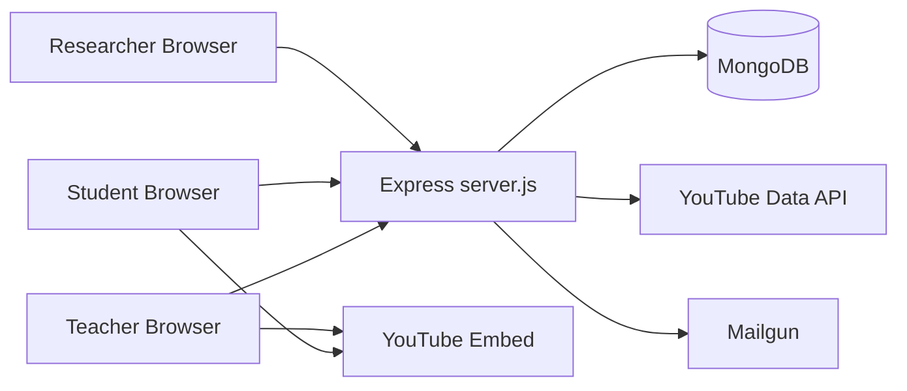
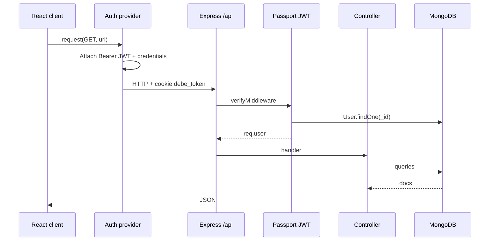
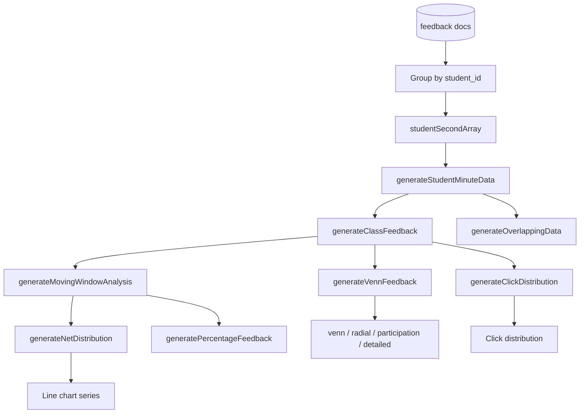

# Architecture Diagrams

## Tech stack

| Layer | Technology |
|---|---|
| Runtime | Node.js 24 LTS (`.node-version`, `engines.node >= 24`) |
| Server | Express 4.22, Passport 0.7 (`passport-local`, `passport-jwt`), jsonwebtoken 9 (HS256), bcrypt 6, express-rate-limit 8, Handlebars (`hbs`) for the reset-password pages, in-house CSRF middleware |
| Database | MongoDB (6.0/7.0 tested) via Mongoose 8 / MongoDB driver 6; express-session store: connect-mongo 6 |
| Integrations | YouTube Data API v3 (`fetch`, page-scrape fallback without `GOOGLE_API_KEY`), Mailgun (`mailgun.js`), ExcelJS exports |
| Client | React 17 + React Router 5, built with Vite (`client/`, dev server on :8080 proxying `/api/`) |
| Tests / CI | Jest 30 + supertest (backend), Playwright (e2e, `e2e/`), GitHub Actions (`.github/workflows/ci.yml`) |
| Deploy | PM2 (`ecosystem.config.js`) behind nginx |

## System context

## Request path (authenticated teacher)

## Feedback analysis pipeline

